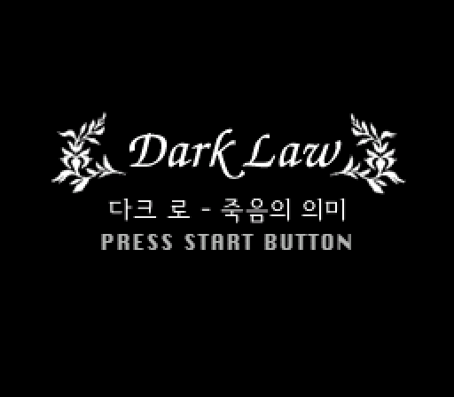
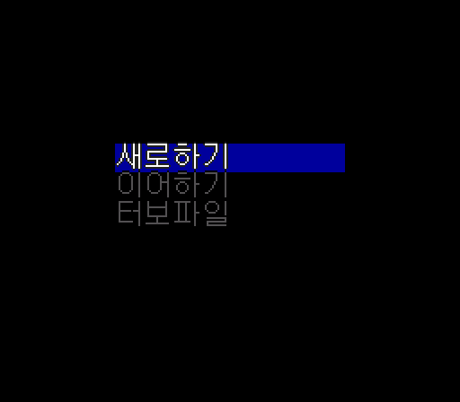
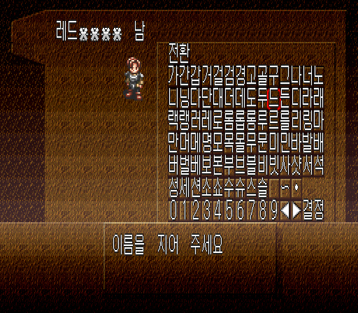
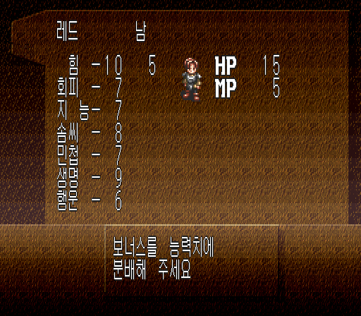
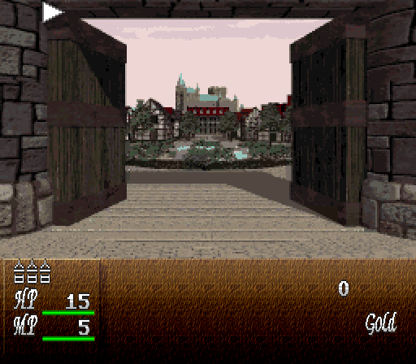
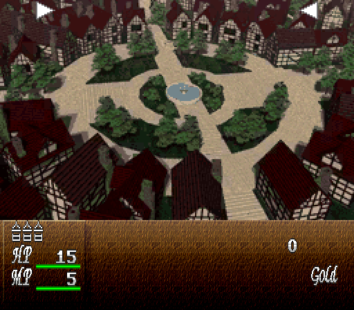
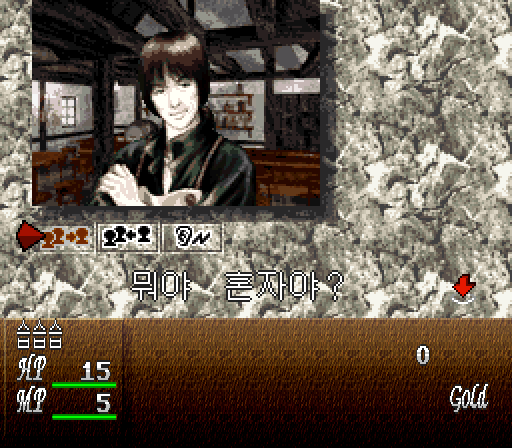
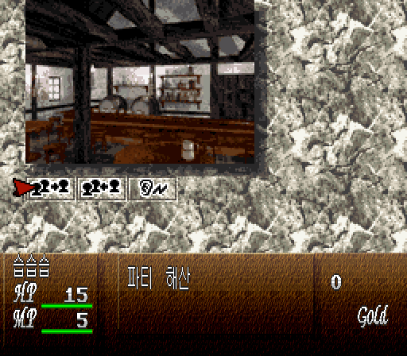
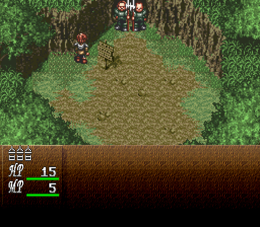

# 다크 로 - 죽음의 의미 — 슈퍼 패미컴 한글패치

일본판 **ダークロウ ～Meaning of Death～(다크 로 - 죽음의 의미)**(슈퍼 패미컴, 1997, 아스키)의 비공식 한글패치 **v1.0.1 (2026-11-16)** 입니다. 외부 기계 번역 없이 직접 번역했습니다.

[정식 패치 다운로드](https://github.com/snake759494/dark-law-sfc-korean-patch/releases/latest) · [빌드](docs/BUILD.md) · [기술 설명](docs/TECHNICAL.md) · [검증 범위](docs/VALIDATION.md) · [변경 이력](CHANGELOG.md) · [권리 안내](RIGHTS.md)

## 게임 소개

『다크 로 - 죽음의 의미』는 아스키가 1997년 3월 슈퍼 패미컴으로 낸 RPG입니다. 레이폴 왕국의 마을 술집에서 의뢰를 받아 동료와 파티를 짜고, 던전과 필드를 오가며 사건을 해결하는 시나리오 선택형 구성이 특징입니다. 전투는 필드 위에서 행동 게이지를 쓰며 이동·공격·방어·마법을 고르는 방식이며, 프리렌더 CG로 그린 마을과 3D 시점의 거리 화면도 볼거리입니다. 일본 외에서는 정식 발매되지 않았습니다.

## 적용 방법

1. 직접 준비한 원본 일본판 ROM(4MB, 헤더 없음)의 SHA-256이 아래 `source`와 일치하는지 확인합니다.
2. 릴리즈에서 **Dark_Law_SFC_KR.xdelta** 하나를 받습니다.
3. xdelta UI 또는 아래 명령으로 원본에 적용합니다. 결과 ROM 크기는 원본과 같은 4MB입니다.
4. 결과 ROM의 SHA-256을 확인한 뒤 새로 부팅합니다. 원본에서 만든 세이브 스테이트는 쓰지 마세요(SRAM 세이브는 그대로 쓸 수 있습니다).

```powershell
.\xdelta.exe -d -s 'Dark Law - Meaning of Death (Japan).sfc' 'Dark_Law_SFC_KR.xdelta' 'Dark Law - Meaning of Death (Korean).sfc'
Get-FileHash -Algorithm SHA256 'Dark Law - Meaning of Death (Korean).sfc'
```

원본·패치·결과 해시를 한 번에 확인하려면 저장소의 `tools/apply_release.py`를 사용할 수 있습니다.

| 구분 | 바이트 | SHA-256 |
| --- | ---: | --- |
| source | 4,194,304 | `6c1749b24124f74d3aceefa24297b836b6ee7598fc2094f4d065b3c762c898a4` |
| output | 4,194,304 | `e46f0465e08067ac1683e3cff81a1d4a6e91bb91c36546ada70f0ba8955777e5` |
| patch | 265,219 | `0a99356840b6112cbefc72a6cd5b6363d71942b4d6e11fdf2a002d17a88a23ae` |

xdelta는 압축 없이 **`-e -0 -S none`**으로 빠르게 생성했습니다. 릴리즈 첨부는 xdelta 하나이며 ROM·글꼴·외부 실행 파일·저장 파일은 포함하지 않습니다.

## 한글화 내용

- **대사 전체**: 이벤트 대사·선택지·안내문 **2,150개**, 술집 힌트 **140개**.
- **아이템·마법·직업·몬스터 이름**, 아이템 설명, 장비 설명, 메뉴 도움말 등 이름·메뉴 데이터 **336종**.
- **메뉴**: 필드 메뉴, 상태창, 장비·도구·마법 창, 상점 목록, 이름 입력 화면, 능력치 분배 화면, 전투 메시지.
- **예/아니오** 선택지(원본 그림 글자 「はい/いいえ」)를 「예/아니오」로 교체.
- **시나리오 제목** 81개, **타이틀 화면** 한글 부제 「다크 로 - 죽음의 의미」.
- 글꼴: 대사 **갈무리14**, 상점·목록 작은 글꼴 **갈무리7**, 늘리거나 줄이지 않은 원래 크기. 타이틀 부제는 서울한강체 M.

 
 
 
 


## 원문·영문으로 남은 부분

- 타이틀 로고 「Dark Law」, 저작권 표기, `HP`·`MP`·`Gold` 등 영문 표기.
- 이름 입력 화면에서 고를 수 있는 한글은 글자 칸 수 제한으로 자주 쓰는 음절 위주입니다.

## 검증 범위

헤드리스 snes9x(libretro)로 최종 해시의 ROM을 실행해 타이틀, 새로 하기, 이름 입력, 능력치 분배, 오프닝 대사, 마을 입구·마을·술집 대사와 메뉴, 상점 목록과 예/아니오, 필드, 첫 동굴 전투(출현·공격·데미지·방어·마법·도구 메시지)와 패배 후 여관을 확인했습니다. 일부 구간은 치트(퍼즐·문지기 우회)로 이동해 확인했습니다. 공개 도구로 재빌드한 결과가 릴리즈 ROM과 바이트 단위로 같음을 확인했습니다. 검증용 에뮬레이터는 종료했습니다.

**전체 시나리오 진행, 엔딩, 실기 검증은 미실시입니다.** 자세한 내용은 [검증 문서](docs/VALIDATION.md)를 확인하세요.

## 공개 자료

`translation/`에 직접 번역한 한국어 문장을, `tools/`에 빌드 도구(파이썬)를, `data/`에 문자열 주소 같은 구조 정보만 공개합니다. 일본어 원문은 포함하지 않으며 빌드 시 사용자 ROM에서 읽습니다. 재빌드에는 사용자가 준비한 원본 ROM과 해시가 맞는 글꼴이 필요합니다. 이 저장소는 원작이나 글꼴의 권리를 부여하지 않습니다.

문제 제보에는 원본·결과 ROM 해시, 발생 위치, 재현 순서와 화면 캡처를 첨부해 주세요. ROM 파일과 저장 파일은 공개 이슈에 올리지 마세요.
